<div dir="rtl">

# تابلو قیمت — PriceBoard

تابلوی **قیمت لحظه‌ای طلا، سکه و نقره** که چند منبع ایرانی را هم‌زمان می‌خواند، کنار هم مقایسه می‌کند و همان فید را به‌صورت **API فروشی** (با کیف پول، پلن اشتراکی و فاکتور رسمی) در اختیار کسب‌وکارها می‌گذارد.

> فلسفهٔ پروژه: **هیچ عددی حدس زده نمی‌شود.** هر قیمت از یک منبع واقعی می‌آید، از چند لایه کنترل سلامت عبور می‌کند و با تاریخچه ثبت می‌شود — و اگر منبعی از دسترس خارج شد، نفر بعدی بی‌وقفه جایش را می‌گیرد.

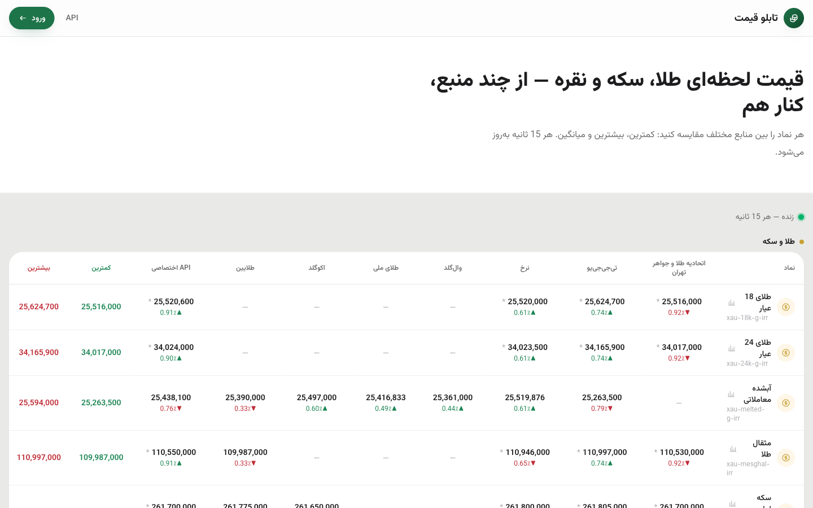

---

## فهرست

- [امکانات](#امکانات)
  - [سایت عمومی](#۱-سایت-عمومی)
  - [موتور قیمت](#۲-موتور-قیمت-pricing-engine)
  - [منابع قیمت](#۳-منابع-قیمت)
  - [پنل ادمین](#۴-پنل-ادمین)
  - [API فروشی + پنل مشتری](#۵-api-فروشی--پنل-مشتری)
  - [مالی و حسابداری](#۶-مالی-و-حسابداری)
  - [ورود، کاربران و دسترسی](#۷-ورود-کاربران-و-دسترسی)
  - [تاب‌آوری و مانیتورینگ](#۸-تاب‌آوری-و-مانیتورینگ)
- [ساختار فنی](#ساختار-فنی)
- [راه‌اندازی (local)](#راه‌اندازی-local)
- [تست](#تست)
- [مستندات](#مستندات)

---

## امکانات

### ۱) سایت عمومی

- **تابلوی مقایسه** (صفحهٔ اصلی): هر نماد × هر منبع، با کمترین/بیشترین، درصد تغییر، جهت (سبز/قرمز)، نشان کهنگی قیمت و نشانگر «محاسبه‌شده» برای قیمت‌های مشتق. قیمت‌ها به **تومان** نمایش داده می‌شوند (ذخیره‌سازی همیشه ریال است). رندر سمت سرور + به‌روزرسانی هر ۱۵ ثانیه با ETag و افکت فلش — بدون رفرش صفحه.
- **صفحهٔ اختصاصی هر نماد** (`/price/{symbol}`): نمودار زنده، مقایسهٔ منابع، نمادهای هم‌گروه و سئوی کامل (canonical/OG، دادهٔ ساخت‌یافتهٔ JSON-LD از نوع `Product`/`AggregateOffer` با قیمت دقیق، سایت‌مپ برای هر نماد و robots پویا).
- **تابلوی تلویزیونی** (`/tv`): تمام‌صفحه، زمینهٔ تیره، فونت به اندازهٔ کاشی (`cqi`)، ساعت و تاریخ شمسی، Wake Lock و حالت تمام‌صفحه — مناسب نمایشگر مغازه. هر کاشی **یک** قیمت مؤثر را نشان می‌دهد (همان عددی که API می‌دهد).
- **صفر درخواست بیرونی**: فونت وزیرمتن self-host، نمودار KLineCharts هم self-host (TradingView در ایران مسدود است)، هیچ CDNای در کار نیست. این قید با تست e2e تضمین شده است.
- راست‌به‌چپ کامل، ارقام لاتین در همه‌جا، واکنش‌گرا تا عرض 375px.

| | |
|---|---|
| 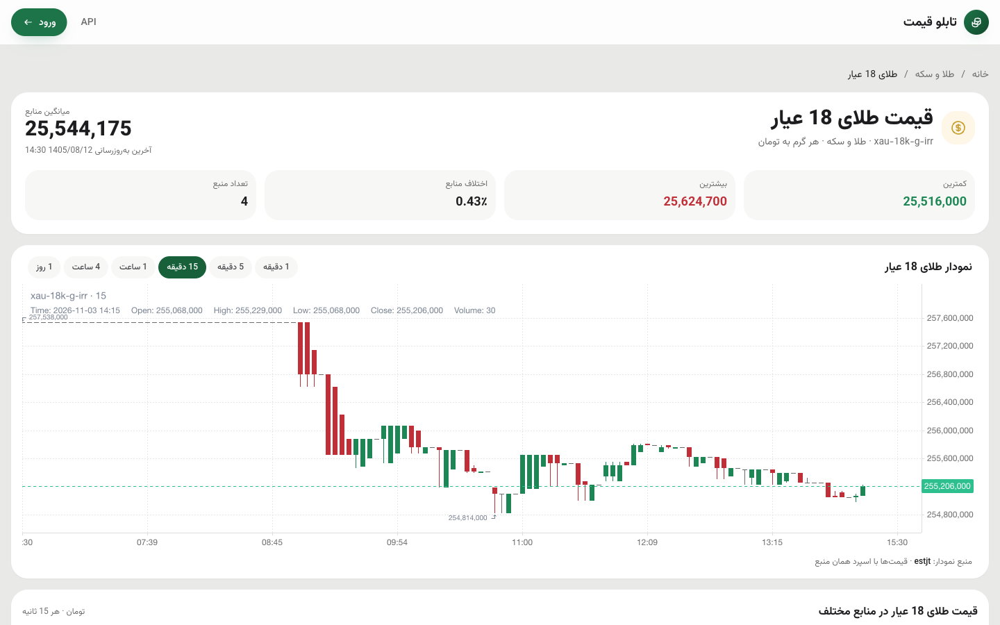 | 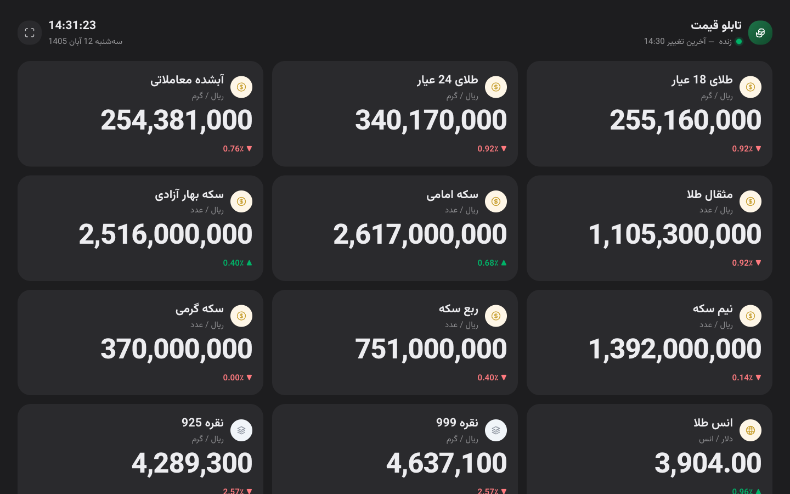 |

### ۲) موتور قیمت (Pricing Engine)

قلب پروژه: یک **پایپ‌لاین ۵ مرحله‌ای** (`Fetch → Validate → Enrich → Persist → Publish`) که هر ۱۵ ثانیه توسط یک worker مجزا (هم‌تراز با شبکهٔ زمانی، بدون رانش) اجرا می‌شود.

- **دریافت هم‌زمان** با `Http::pool` — کندترین منبع طول tick را تعیین می‌کند، نه جمعِ همه. (استعلام اتحادیه حدود ۷ ثانیه طول می‌کشد؛ اگر سریالی می‌زدیم، منبع سوم tick را می‌شکست.)
- **تلاش مجدد هوشمند** فقط برای خطاهای گذرای اتصال (TLS/connect/reset) — خطای timeout و 4xx/5xx عمداً تکرار نمی‌شوند؛ تلاش‌های مجدد هم هم‌زمان‌اند و به بودجهٔ باقی‌ماندهٔ tick محدود می‌شوند.
- **کنترل سلامت چندلایه**: باند مطلق هر نماد، انحراف tick به tick، مقایسهٔ **بین‌منبعی با میانه** برای اولین قیمت هر منبع تازه (در برابر خطای ۱۰ برابری و تومان/ریال) و **مرجع اعتماد** (trust anchor) که ادمین انتخاب می‌کند.
- **تازگی (freshness) به تفکیک (منبع، نماد)**: فیدهای ایرانی شب‌ها و جمعه‌ها یخ می‌زنند و نمادهای جهانی آخر هفتهٔ میلادی — هر کدام سقف مخصوص خودشان را دارند؛ قیمت کهنه با **نشان سن** می‌ماند و گم نمی‌شود.
- **قیمت هیچ‌وقت float نیست**: همیشه `bigint` در واحد خرد + `scale`، و تجزیه با bcmath. اسپرد هر منبع روی **خواندن** اعمال می‌شود، نه نوشتن — عدد خامِ تاریخچه هرگز دست نمی‌خورد.
- **ضربان نویسنده (heartbeat)**: اگر نویسندهٔ تابلو از کار بیفتد (حتی OOM خاموش Redis)، تابلو خودکار به Postgres برمی‌گردد و وضعیت `degraded` اعلام می‌شود.
- **صف ذخیرهٔ Influx**: قطعی InfluxDB هیچ tickای را نمی‌اندازد — tickها در Redis صف می‌شوند، با replay برمی‌گردند و کندل‌های همان بازه **دوباره ساخته می‌شوند** (هیچ حفرهٔ دائمی در نمودار نمی‌ماند).

### ۳) منابع قیمت

هر منبع یک آداپتور `QuoteSourcePort` با **fixture واقعی** و تست عدد به عدد:

| منبع | نوع | چه می‌دهد | نکتهٔ فنی |
|---|---|---|---|
| اتحادیه طلا و جواهر تهران (estjt) | مرجع | ۹ نماد | اسکرپ HTML با DOMXPath؛ جداکنندهٔ «٫»؛ HTTP/1.1 اجباری |
| تی‌جی‌جی‌یو (tgju) | مرجع | ۱۶ نماد (+ جفت‌قیمت آبشده) | تایم‌استمپ به تفکیک نماد؛ از فید ۹۶۳ کلیدی فقط کلیدهای نگاشت‌شده خوانده می‌شوند |
| نرخ (nerkh) | مرجع | ۱۴ نماد | «مظنه» → **آبشده** (تقسیم بر 4.3318)؛ **نقرهٔ 999/925 محاسباتی** از انس × دلارِ خودِ فید |
| وال‌گلد (wallgold) | پلتفرم | آبشده + نقره 925 (جفت‌قیمت) | توکن Bearer؛ هر (نماد، سمت) یک درخواست جدا |
| طلای ملی (melligold) | پلتفرم | آبشده (جفت‌قیمت) | چالش کوکی ArvanCloud به‌صورت خودکار رد می‌شود |
| اکوگلد (ecogold) | پلتفرم | آبشده، ۳ سکه، نقره 999 (جفت‌قیمت) | تومان با ۸ رقم اعشار |
| طلایین (tlyn) | پلتفرم | آبشده، مثقال، ۳ سکه، انس (جفت‌قیمت) | قیمت‌ها به هزار تومان |
| **API اختصاصی** | داخلی | همهٔ نمادها | قیمت خودِ ما — توضیح پایین |

- **«۱۸ عیارِ» پلتفرم‌ها در واقع قیمت معاملهٔ آبشده است** — همه به `xau-melted-g-irr` نگاشت شده‌اند تا مقایسه صادقانه باشد.
- **اولویت به تفکیک نماد**: برای هر نماد زنجیرهٔ منابع قابل تنظیم است (مثلاً آبشده: اول اتحادیه، بعد tgju و…). فید مؤثر همیشه اولین منبع **تازهٔ** زنجیره است.
- **«API اختصاصی»** (منبع داخلی): قیمت خود ما که **خودکار** از زنجیرهٔ اولویت پر می‌شود، ادمین می‌تواند برای هر نماد آن را دستی override کند (حالت «فقط دستی»، ایمپورت اکسل) و اگر همهٔ منابع قطع شوند، فید فروشی از همین زنده می‌ماند — همراه با هشدار.
- افزودن منبع جدید یک دستورعمل ۷ مرحله‌ای دارد (`.claude/skills/add-price-provider`) — fixture واقعی، تست جامع و مقایسه با tgju اجباری است.

### ۴) پنل ادمین

پنل کامل فارسی/RTL روی `/dashboard` (Tailwind v4 + Alpine، تم مبتنی بر توکن):

- **میزکار**: کارت‌های آماری، سلامت هر منبع (تأخیر، نماد، ردشده، خطا)، گیج درصد سلامت و جدول مقایسهٔ زنده.
- **منابع قیمت**: تنظیمات + سلامت هر منبع در یک کارت؛ روشن/خاموش **بدون رفرش** (SPA)؛ اسپرد به تفکیک نماد با پیش‌نمایش سمت سرور؛ مرجع اعتماد؛ لوگو از کتابخانهٔ رسانه.
- **تنظیم قیمت نمادها**: زنجیرهٔ اولویت هر نماد (جابه‌جایی/بالا/پایین)، وضعیت «API اختصاصی» و ایمپورت/اکسپورت اکسل با پیش‌نمایش سطر به سطر.
- **ماتریس نمادها**: هر خانه = قیمت + سن + اختلاف بین منابع؛ ارزان‌ترین/گران‌ترینِ هر سطر مشخص است.
- **نمودار قیمت**: کندل/خطی از ۵ دقیقه تا **سالانه با تقویم شمسی** (هفته از شنبه)؛ هم‌پوشانی چند منبع روی یک نمودار با تولتیپ اختلاف؛ لینک مستقیم قابل اشتراک.
- **پایش**: گزارش هر tick (چه قبول/رد شد و چرا) + **مینی‌تلسکوپ upstream**: تک‌تک درخواست‌های واقعی به منابع با هدر/بدنه/مدت/تلاش مجدد، با پنهان‌سازی مقادیر حساس.
- **مشتریان**: CRUD، غیرفعال‌سازی (نشست‌های باز بلافاصله می‌افتند)، شارژ/کسر دستی کیف پول با دلیل و ممیزی، نمودار مصرف API، ویرایش با ثبت قبل/بعد.
- **تیکت‌ها**: صندوق ورودی، گفت‌وگو با پیوست خصوصی (لینک امضادار)، گذار وضعیت با تاریخچه، اطلاع‌رسانی پیامکی.
- **دسترسی (RBAC)**: نقش/مجوز قابل تعریف توسط خود ادمین، محافظ «آخرین مدیر».
- **سئو / رسانه**: ویرایشگر `seo_meta` هر صفحه؛ کتابخانهٔ آپلود با جلوگیری از حذف فایل در حال استفاده.

| | |
|---|---|
| 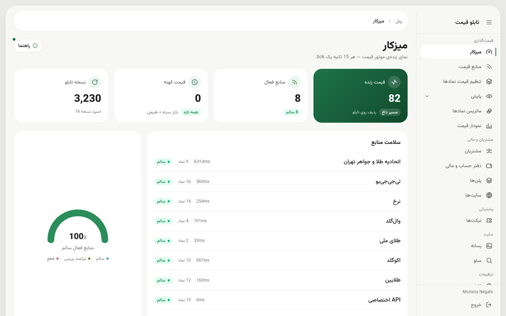 | 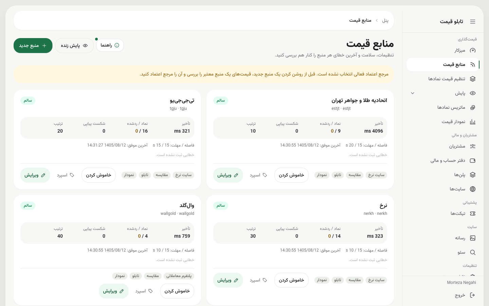 |
| 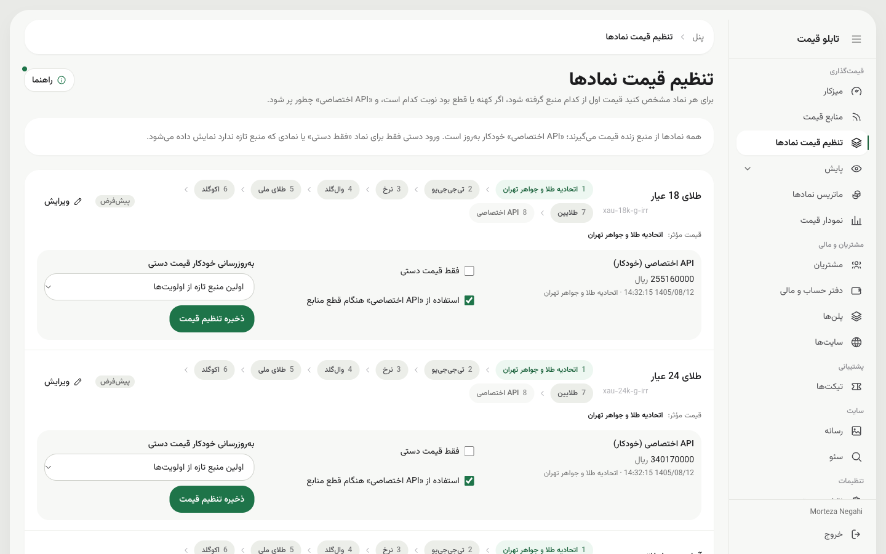 | 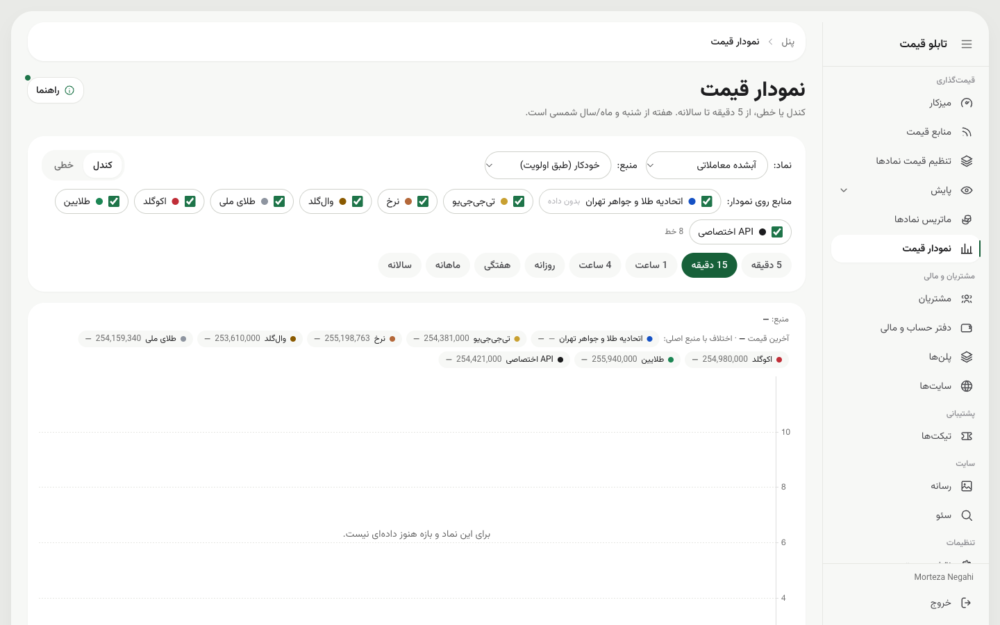 |
| 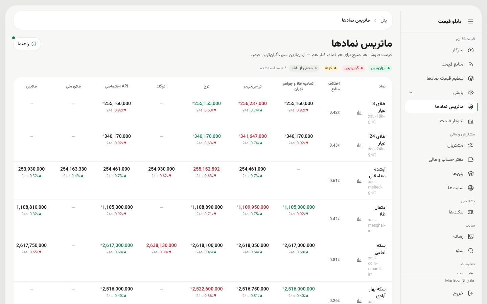 | 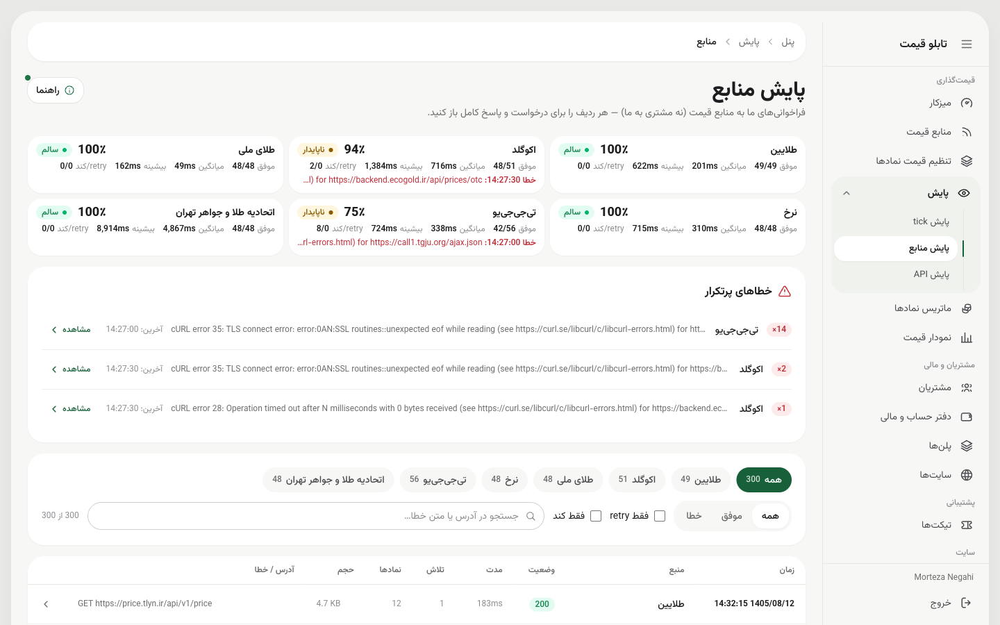 |

### ۵) API فروشی + پنل مشتری

- **احراز هویت HMAC**: امضای canonical با client/secret، نانس یک‌بارمصرف (fail-closed)، اختلاف ساعت مجاز ±۳۰ ثانیه و decoy-HMAC در برابر حملات زمانی.
- **اندپوینت‌ها**: `GET /v1/{instruments, providers, prices, prices/{symbol}, effective, candles, wallet}` — همه با ETag (پاسخ 304 **هزینه ندارد**).
- **شارژ به ازای هر فراخوانی**: رزرو اتمی با Lua روی Redis + ثبت در دفتر کل Postgres (منبع حقیقت)؛ **fail-closed** (قطعی Redis یا PG یعنی 503 — سرویس مجانی نمی‌دهیم).
- **Idempotency واقعی**: با `X-Pb-Request-Id` ثابت، همان پاسخ تا ۲۴ ساعت بدون کسر دوباره برمی‌گردد؛ همان شناسه با درخواست متفاوت یعنی 409.
- **بازگشت وجه خودکار** روی خطا/304 — و اگر درست همان لحظه دیتابیس قطع بود، بازگشت در صف پایدار می‌ماند و زمان‌بند آن را replay می‌کند (پول مشتری گم نمی‌شود).
- **پلن اشتراکی**: ادمین پلن می‌سازد (مدت، سهمیهٔ کل، سقف روزانه، نرخ مازاد)؛ فراخوانی داخل سهمیه رایگان، مازاد به‌صورت pay-as-you-go؛ سقف روزانه یعنی 429.
- **پنل self-serve مشتری** (`/account`): ساخت سایت (نمایش یک‌بارهٔ credential)، خرید پلن از کیف پول، شارژ با درگاه **وندار** (verify با idempotency)، دفتر کل، نمودار مصرف و تیکت.
- **تأیید سایت**: ثبت سایت → تیکت خودکار → استعلام **اینماد** → تأیید ادمین → فعال شدن API.
- **احراز هویت با زحل (KYC)**: شاهکار (موبایل ↔ کد ملی)، هویت حقیقی، شرکت، کد پستی — گزارش خودکار روی تیکت (هر استعلام هزینه دارد؛ فقط یک بار + دکمهٔ اجرای دوباره).
- **فاکتور رسمی** با شمارهٔ متوالی (`PB-YYYY-NNNNNN`) و اسنپ‌شات **تغییرناپذیر** از هویتِ تأییدشده (فقط از پروفایل تأییدشدهٔ KYC).

### ۶) مالی و حسابداری

- جدول `wallet_transactions` **فقط‌افزودنی (append-only)** است — با **تریگر دیتابیس** (UPDATE/DELETE/TRUNCATE رد می‌شود، حتی cascade).
- حسابداری **دوطرفه** (journal) برای هر حرکت پول.
- صفحهٔ «امور مالی»: دفتر کل همهٔ کاربران با فیلتر/جست‌وجو/CSV، **گزارش ماهانه به تقویم شمسی**، تسویهٔ درگاه، صدور فاکتور دستی و شارژ کیف پول.
- «ویرایش/حذف» سند وجود ندارد — فقط **سند برگشت** (ابطال) با دلیل، نام ادمین و ارجاع به سند اصلی. idempotent.

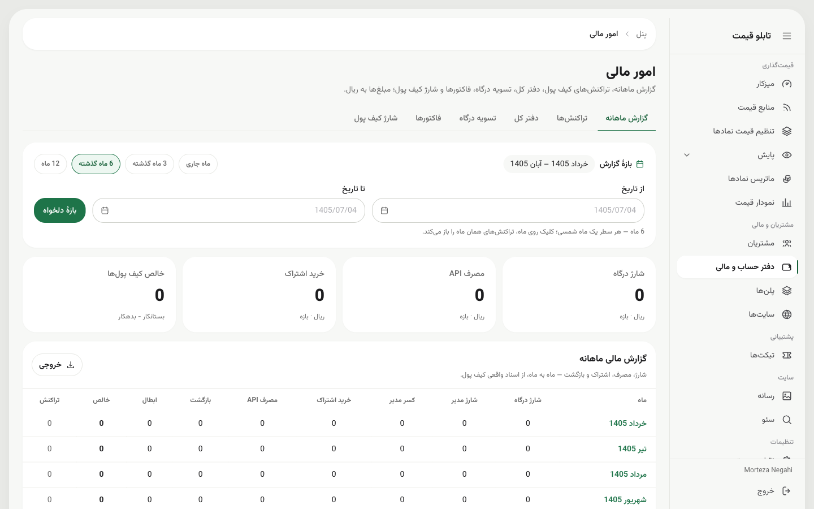

### ۷) ورود، کاربران و دسترسی

- **ورود فقط با موبایل + کد یک‌بارمصرف** — هیچ رمز عبوری ذخیره نمی‌شود.
- کدها به‌صورت **هش HMAC** در Redis نگهداری می‌شوند (dump ردیس بدون APP_KEY بی‌استفاده است)، یک‌بارمصرف با مصرف اتمی، و ۳ خطا یعنی ابطال کد.
- **محدودیت نرخ جداگانه برای شماره و IP** (ارسال و تأیید)، ایمن در برابر enumeration (پاسخ برای شمارهٔ موجود و ناموجود بایت به بایت یکی است) و محافظت در برابر session fixation.
- کاربر غیرفعال‌شده: نشست‌های باز بلافاصله می‌افتند، کد درست هم رد می‌شود و APIهای سایت‌هایش 403 می‌گیرند.
- ممیزی کامل تغییرات پروفایل (چه کسی، کی، قبل/بعد)؛ تغییر هویت بعد از KYC، تأییدیه را **خودکار باطل** می‌کند.

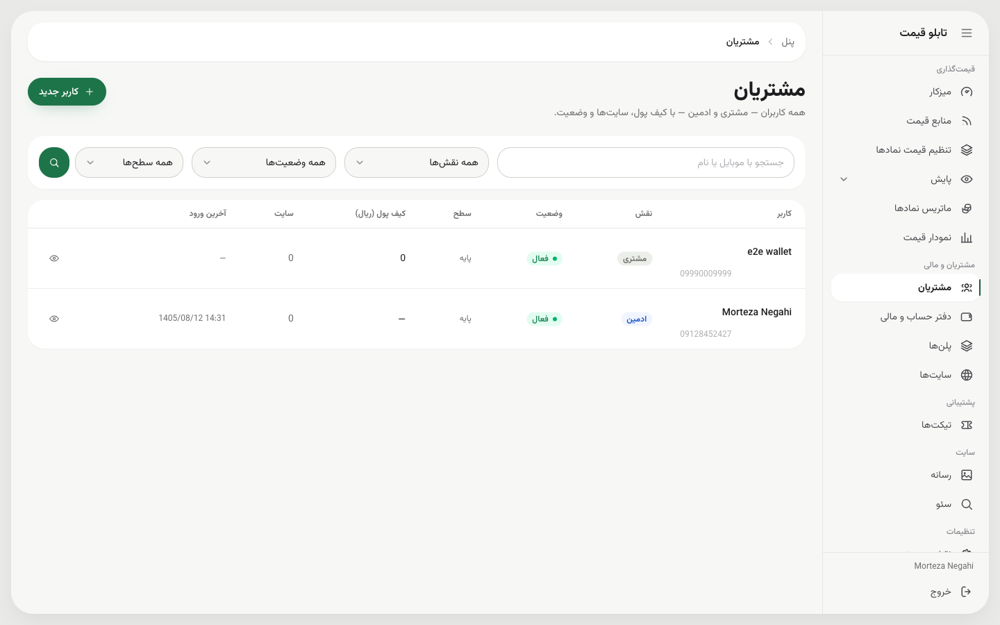

### ۸) تاب‌آوری و مانیتورینگ

سناریوهای قطعی **روی محیط واقعی** تست شده‌اند (`scripts/resilience-check.sh`، ۳۰ بررسی):

| چه قطع شود | چه می‌شود |
|---|---|
| InfluxDB | tickها صف می‌شوند؛ با replay برمی‌گردند و کندل‌ها دوباره ساخته می‌شوند — **هیچ حفره‌ای** نمی‌ماند |
| Redis | تابلو به Postgres برمی‌گردد و خودش را `degraded` اعلام می‌کند |
| PostgreSQL | tick عمداً رد می‌شود (بدون کنترل سلامت نمی‌نویسیم) ولی تابلو از Redis زنده می‌ماند |
| یک منبع | بقیه ادامه می‌دهند؛ فید مؤثر به منبع بعدیِ زنجیره می‌رود |
| همهٔ منابع | «API اختصاصی» (آخرین قیمت سالم) سرو می‌شود + هشدار در پنل |

- **Horizon** (صف) و **Telescope** (فقط local، با پنهان‌سازی داده‌های حساس) پشت مجوز دسترسی.
- `pricing:influx:health`: ۵ بررسی سلامت کندل/تسک/صف — زمان‌بند هر ۵ دقیقه.
- لاگ ساخت‌یافتهٔ JSON برای هر tick (`pricing.upstream` / `pricing.stored` / `pricing.rejected`) — آمادهٔ Filebeat/Kibana.

---

## ساختار فنی

**پشته**: Laravel 13 · PHP 8.5 · PostgreSQL 18 · Redis 8 (یک نمونه، DB0/1/2) · InfluxDB 2.7 · Octane/Swoole · Alpine 3 · Tailwind v4 · Vite 8 · KLineCharts 10 (self-host) · Docker · Playwright

### معماری: Modular Monolith + Ports & Adapters + CQRS-lite

</div>

```
app/Modules/{Module}/
├── Domain/           ← PHP خالص: ValueObject، Enum، Service، Port (interface)
│                        هیچ‌چیزِ لاراول اینجا نیست — نه Facade، نه Eloquent، نه config()
├── Application/      ← use-case ها: Action (نوشتن) · Query (خواندن) · Dto · Pipeline
└── Infrastructure/   ← تنها جایی که دنیای بیرون هست: Eloquent، Redis، Http، Influx
```

<div dir="rtl">

- لایهٔ UI (کنترلر/Blade) **فقط** `Action`/`Query` صدا می‌زند — هیچ Eloquent مستقیمی. یک تست معماری (`LayerRulesTest`) این قوانین را روی **سورس‌کد** اجبار می‌کند + Larastan سطح ۶.
- هر یکپارچه‌سازی بیرونی یک **Port** است با آداپتور + fake + bind + **تستِ bind**. کل پایپ‌لاین قیمت بدون Docker و دیتابیس تست می‌شود.
- زیر Octane هیچ حالت مشترک خطرناکی وجود ندارد: کلاینت‌های mutable هرگز bind نمی‌شوند (Influx و زحل با `Http` خود لاراول کار می‌کنند، نه SDK).

### ماژول‌ها

| ماژول | وظیفه |
|---|---|
| `Pricing` | موتور قیمت: منابع، پایپ‌لاین، کنترل سلامت، اسپرد، اولویت، فید تابلو/TV/نمودار/سئو |
| `Api` | احراز HMAC، شارژ هر فراخوانی، پلن/اشتراک، مصرف، inspector |
| `Wallet` | کیف پول فقط‌افزودنی + idempotency |
| `Billing` | درگاه وندار، شارژ، فاکتور رسمی |
| `Finance` | دفتر کل، journal، گزارش ماهانه، ابطال/اصلاح |
| `Auth` | کد یک‌بارمصرف، پیامک (کاوه‌نگار)، کاربران، ممیزی |
| `Access` | نقش و مجوز پویا (RBAC) |
| `Ticket` | تیکت + پیوست خصوصی + گذار وضعیت |
| `Kyc` | آنبوردینگ، استعلام‌های زحل، تأیید سطح |
| `Seo` | متا/JSON-LD/سایت‌مپ/robots + ویرایشگر |
| `Media` | آپلود + کتابخانه + ردیابی مصرف |
| `Panel` / `Common` | پوستهٔ داشبورد، کامپوننت‌ها، هلپرها (Money، Jalali، PhoneHelper و…) |

### جریان یک tick (هر ۱۵ ثانیه)

</div>

```
price-worker (کانتینر جدا، هم‌تراز با شبکهٔ ۱۵ ثانیه‌ای)
   │
   ▼
Fetch ──── دریافت هم‌زمان با Http::pool + تلاش مجدد خطای گذرا + لاگ upstream
   ▼
Validate ─ باند مطلق · انحراف tick به tick · تازگی به تفکیک (منبع، نماد)
           · مقایسهٔ بین‌منبعی اولین tick (میانه) · مرجع اعتماد
   ▼
Enrich ─── جهت، باند روز (ریست با نیمه‌شب تهران)
   ▼
Persist ── Postgres (اسنپ‌شات) + Redis (تابلوی داغ، یک کلید) + Influx (tick)
           + پشتیبان‌گیری خودکار «API اختصاصی»   ← همه isolated: یکی بیفتد، بقیه زنده‌اند
   ▼
Publish ── نسخهٔ جدید + ضربان (heartbeat)
```

<div dir="rtl">

### سه انبار داده، سه نقش

| انبار | نقش |
|---|---|
| **PostgreSQL** | منبع حقیقت: آخرین اسنپ‌شات‌ها، منابع، کاربر/کیف پول/دفتر کل (حدود ۳۵ جدول؛ مایگریشن همیشه افزایشی) |
| **Redis** (DB0 نشست/صف · DB1 کش · DB2 قیمت‌ها؛ `noeviction` + AOF) | تابلوی داغ در **یک کلید** (یک رفت‌وبرگشت)، قفل tick، آینهٔ شارژ API، صف ذخیره |
| **InfluxDB 2.7** | tickهای خام (۳۰ روز) + کندل‌های `1m` تا `1d` با تسک‌های Flux؛ هفتگی/ماهانه/سالانه **با تقویم شمسی در PHP** تجمیع می‌شوند |

### کیفیت

- **۱,۴۴۶ تست PHP** (۶,۴۳۳ assertion) — SQLite در حافظه + Redis تست (DB13/14/15)؛ هیچ تستی به منبع/درگاه/پیامک واقعی وصل نمی‌شود (fixtureهای واقعی در `tests/Fixtures/`).
- **۱۲۷ تست Playwright** (e2e) روی پشتهٔ واقعی Docker — از ورود با کد یک‌بارمصرف تا خرید پلن و تسویه.
- **Mutation check** روی سازوکارهای حساس: تستی که با خراب‌کردن کد سبز بماند، چیزی را ثبت نکرده است.
- **Larastan سطح ۶** + Pint + تست معماری.
- Fakeهای هر Port **همان قرارداد واقعی را امضا می‌کنند** (تست قرارداد روی هر دو پیاده‌سازی) — fake مهربان‌تر از آداپتور ممنوع است.

---

## راه‌اندازی (local)

</div>

```sh
cp .env.example .env            # مقادیر و APP_KEY را خودتان پر کنید؛ .env را commit نکنید
docker compose -f docker-compose.local.yml up -d --build

dc="docker compose -f docker-compose.local.yml exec octane"
$dc php artisan migrate --force                 # همیشه افزایشی — هیچ migrate:fresh روی دادهٔ واقعی
$dc php artisan db:seed                         # ProviderSeeder (همه غیرفعال) + AdminSeeder
$dc php artisan pricing:influx:provision --tokens   # باکت/تسک‌های Influx + توکن‌های read/write → .env
docker compose -f docker-compose.local.yml up -d --force-recreate   # بعد از هر تغییر .env

npm install && npm run build
$dc php artisan octane:reload                   # بعد از هر build فرانت
```

<div dir="rtl">

سپس در پنل (`/dashboard/providers`) منابع لازم را **فعال** کنید و یک مرجع اعتماد (trust anchor) انتخاب کنید. کانتینر `price-worker` هر ۱۵ ثانیه `pricing:tick` می‌زند؛ دستی هم می‌شود:

</div>

```sh
$dc php artisan pricing:tick --force     # یک tick کامل با گزارش در کنسول (--json هم دارد)
$dc php artisan pricing:influx:health    # سلامت کندل‌ها / تسک‌ها
```

<div dir="rtl">

| چی | کجا |
|---|---|
| سایت عمومی (تابلو + نمودار) | http://localhost:8300 · `/tv` تابلوی تلویزیونی |
| پنل ادمین | http://localhost:8300/dashboard (ورود با موبایل + کد؛ `BYPASS_OTP` فقط local) |
| حساب مشتری | http://localhost:8300/account |
| API فروشی | `GET /v1/{instruments,providers,prices,prices/{symbol},effective,candles,wallet}` با HMAC |
| Horizon / Telescope | `/horizon` · `/telescope` (فقط ادمین با مجوز `monitoring.view`؛ Telescope فقط local) |
| Vite HMR · Postgres · Redis · Influx | 5373 · 55434 · 56381 · 8386 |

پورت‌ها عمداً جابه‌جا شده‌اند تا با پروژه‌های دیگر تداخل نکنند — بدون بررسی `docker ps -a` تغییرشان ندهید.

کلیدهای اختیاری `.env`: `WALLGOLD_API_KEY` (منبع وال‌گلد)، `VANDAR_API_KEY` (درگاه)، `ZOHAL_TOKEN` (استعلام هویت)، `KAVENEGAR_*` (پیامک) — بدون آن‌ها همان بخش غیرفعال می‌ماند ولی چیزی نمی‌شکند.

## تست

</div>

```sh
$dc php artisan test --compact        # PHPUnit: SQLite در حافظه + Redis DB13/14/15 (به dev دست نمی‌زند)
$dc composer typecheck                # Larastan سطح ۶
npx playwright test                   # e2e از HOST؛ پشته باید بالا باشد؛ 1 worker
$dc vendor/bin/pint --dirty
```

<div dir="rtl">

تست PostgreSQL مالی (`tests/Integration/FinancePostgresTest.php`) فقط با `PB_TEST_PG_DATABASE=priceboard_verify_*` اجرا می‌شود — هرگز روی دیتابیس dev.

## مستندات

- [`docs/TASKS.md`](docs/TASKS.md) — **کجا هستیم** (اول این را بخوانید)
- [`docs/PLAN.md`](docs/PLAN.md) — نقشه و تصمیم‌ها (چه و چرا)
- [`docs/architecture.md`](docs/architecture.md) — لایه‌ها، پایپ‌لاین، منابع، مالی، اسکیما، عملیات، تست
- [`docs/dashboard-design.md`](docs/dashboard-design.md) — توکن‌ها و کامپوننت‌های تم
- [`CLAUDE.md`](CLAUDE.md) · [`app/Modules/CLAUDE.md`](app/Modules/CLAUDE.md) · [`resources/views/CLAUDE.md`](resources/views/CLAUDE.md) — قوانین کار
- `.claude/skills/` — دستورعمل‌های گام‌به‌گام (`add-price-provider`، `pricing-architecture`، `influx-timeseries`، `dashboard-ui`، `docker-dev`)

</div>
